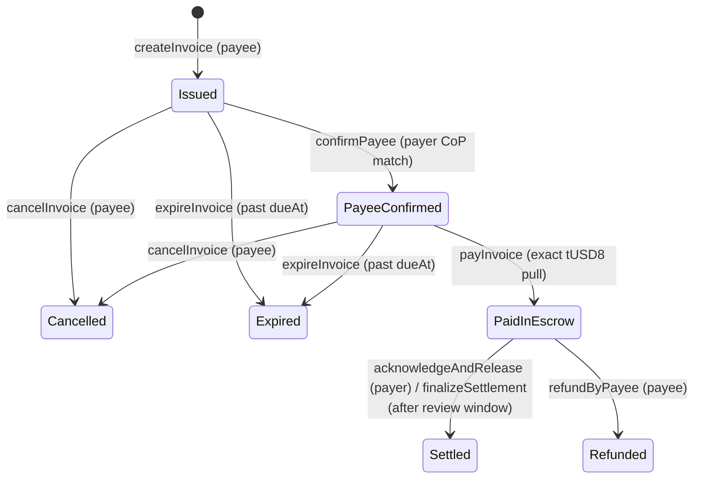

# Clearbill

**Stablecoin Invoicing with Mandatory Confirmation of Payee (CoP) on QDay Aevum Testnet (`44005`).**

Built for the **Aevum Builder Challenge #1 (Invoice Payments + Confirmation of Payee)** using the official Aevum Testnet stablecoin **`tUSD8`** (`0x456569838f1d43009A91ebA4263147Afd7233483`, 6 decimals).

---

## Problem

Sending irreversible stablecoin invoices to raw hex addresses leads to costly fat-finger mistakes and lookalike address spoofing. **Clearbill** enforces an on-chain **Confirmation of Payee (CoP)** gate before a single base unit of `tUSD8` can move, followed by an escrow review window with immediate payer release, deterministic auto-finalization, or voluntary payee refund.

## Architecture & Lifecycle



## Contracts & Demo

| Path | Description |
| --- | --- |
| `src/ClearbillInvoices.sol` | Core invoice & CoP settlement engine bound immutably to official `tUSD8`. Zero admin keys, no upgrade proxy, strict CEI + `nonReentrant`, exact 6-decimal accounting, explorer-verifiable events on every transition. |
| `src/ClearbillRegistry.sol` | Self-sovereign Payee Directory where businesses publish canonical display names and tags for CoP verification. |
| `src/MockTUSD8.sol` | 6-decimal ERC-20 mock used strictly in local Foundry tests. |
| `script/DeployClearbill.s.sol` | Foundry deploy script enforcing `block.chainid == 44005` and binding to official `tUSD8` (`0x456569838f1d43009A91ebA4263147Afd7233483`). |
| `web/` + `Dockerfile` | Zero-dependency interactive demo UI showing empty, loading, error, CoP mismatch blocking, and full settlement states + `cast` commands and Aevum explorer links. |

## Quickstart (Local Tests & Demo UI)

```bash
# Run all 9 Foundry unit tests
forge test -vvv

# Serve the interactive demo UI locally
python3 -m http.server 8080 --directory web
# Or via Docker:
docker build -t clearbill-demo . && docker run -p 8080:8080 clearbill-demo
```

## QDay Aevum Testnet (`44005`) Deployment (Live)

- **Chain ID:** `44005` (script aborts on `44001`, `44003`, or Ethereum mainnet)
- **RPC:** `https://rpc-test.qday.info`
- **Explorer:** `https://explorer-test.qday.info`
- **Official `tUSD8` (6 decimals):** [`0x456569838f1d43009A91ebA4263147Afd7233483`](https://explorer-test.qday.info/address/0x456569838f1d43009A91ebA4263147Afd7233483)
- **Deployed `ClearbillRegistry`:** [`0x5389083b1FbCE68ee6adD211D0E21b74F016EB71`](https://explorer-test.qday.info/address/0x5389083b1FbCE68ee6adD211D0E21b74F016EB71) ([deploy tx](https://explorer-test.qday.info/tx/0x0a0553cf73b5773e2cf7fb738b605894ec450e9a9a3773f64a1a0a1973895ca5))
- **Deployed `ClearbillInvoices`:** [`0x27825D851BC38a216c907a35184da9187dce75a3`](https://explorer-test.qday.info/address/0x27825D851BC38a216c907a35184da9187dce75a3) ([deploy tx](https://explorer-test.qday.info/tx/0x7f7e5867c89b4ff541c7fe80b7a89063b96e9f7542978740874dcea13d5d8127))
- **Official Faucet (`tQDAY` + `tUSD8`):** `https://faucet.qday.info/en`

```bash
PRIVATE_KEY=<throwaway_testnet_pk> \
forge script script/DeployClearbill.s.sol:DeployClearbill \
  --rpc-url aevum_testnet --broadcast
```

## License

MIT — see [LICENSE](./LICENSE). Third-party library: `forge-std` (MIT / Apache-2.0).
